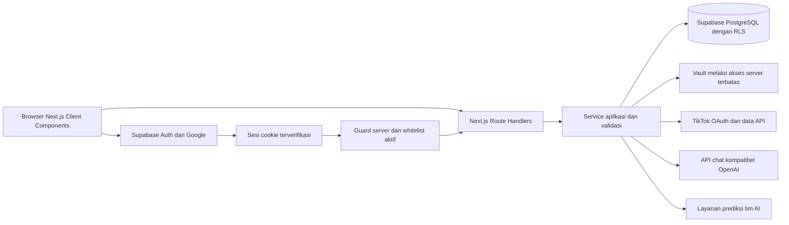
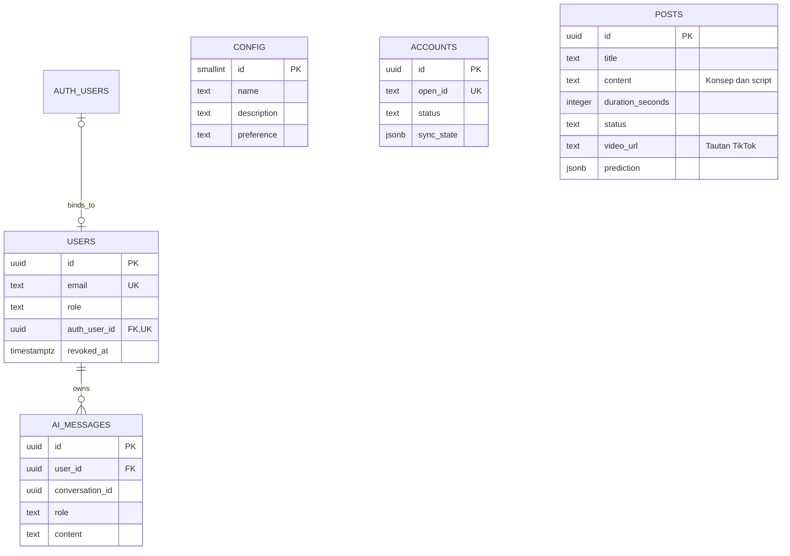

# Rancangan Teknis dan Pembagian Sprint NobNob

Tanggal rancangan 10 November 2026

Status draf untuk review tim. Acuan kebutuhan adalah SRS_NobNob.md. Pembagian halaman dan jumlah sprint mengikuti keputusan pengguna. Pembagian pekerjaan fondasi, library tambahan, nama tabel, dan detail kontrak di bawah merupakan usulan implementasi.

## 1. Pembagian tanggung jawab

| Anggota | Halaman utama | Tanggung jawab pendukung yang diusulkan |
| --- | --- | --- |
| Mada | Dashboard, Posts, AI Studio | Supabase (proyek, skema, migration, RLS, Vault), Auth (login Google, sesi, middleware, dan izin whitelist), kerangka aplikasi, layanan Posts, prediksi, dan AI |
| Cleo | Calendar, Analytics | Tampilan kalender dan ringkasan statistik TikTok terkini dari Novan |
| Novan | Settings, Accounts | Tampilan Settings termasuk whitelist, konfigurasi layanan, koneksi TikTok, dan sinkronisasi metadata/statistik |

PIC halaman menangani antarmuka, Route Handler, validasi, dan integrasi data halaman tersebut. Mada menyediakan skema database serta endpoint Auth dan whitelist yang dipakai Novan di Settings. Perubahan kontrak yang dipakai halaman lain direview oleh konsumennya.

Tim AI menyediakan layanan model prediksi dan definisi hasil. Mada mengintegrasikan layanan itu ke modal Buat Post dan tool AI Studio. Detail Post menampilkan hasil yang sudah tersimpan. Dataset, pelatihan, akurasi, baseline, serta ambang kategori tetap dikelola tim AI.

## 2. Tech stack

### 2.1 Stack utama

| Bagian | Pilihan | Pemakaian |
| --- | --- | --- |
| Aplikasi | Next.js App Router + JavaScript | Satu repository untuk antarmuka dan backend aplikasi |
| Interaksi browser | React Client Components | Form, chat, dialog, kalender, filter, dan grafik |
| Kerangka halaman | Next.js layout/page | Shell, navigasi, dan pemeriksaan akses awal |
| Backend | Next.js Route Handlers di app/api | Mutasi data, integrasi TikTok, AI chat, dan layanan prediksi |
| Database | Supabase PostgreSQL | Data usaha, Posts, tautan video, chat, prediksi |
| Login | Supabase Auth + Google OAuth | Identitas pengguna dan sesi berbasis cookie |
| Pembatasan akses | Guard server + PostgreSQL RLS | Whitelist aktif dan batas usaha |
| Penyimpanan rahasia | Supabase Vault | API key AI serta token akses/refresh TikTok melalui server |

Client Components dipakai untuk form, chat, dan filter. Layout server memeriksa akses dan menampilkan kerangka halaman. Gunakan `.jsx` untuk halaman dan komponen React, serta `.js` untuk logika server dan Route Handlers (`route.js`).

Sumber [Next.js Server and Client Components](https://nextjs.org/docs/app/getting-started/server-and-client-components), [Route Handlers](https://nextjs.org/docs/app/api-reference/file-conventions/route), [Supabase server-side client](https://supabase.com/docs/guides/auth/server-side/creating-a-client?framework=nextjs).

### 2.2 Library pendukung yang diusulkan

| Kebutuhan | Pilihan | Catatan |
| --- | --- | --- |
| Styling | Tailwind CSS | Warna, radius, dan huruf mengikuti mockup NobNob terakhir |
| Dialog dan kontrol dasar | shadcn/ui, pilih komponen seperlunya | Sesuaikan token dengan desain NobNob |
| Form | React Hook Form + Zod | Schema Zod juga divalidasi pada server |
| Cache data API | TanStack Query | Query key bersama dan invalidasi sesudah mutasi |
| Grafik | Recharts | Perbandingan total terkini antarvideo |
| Calendar | Komponen bulan dan agenda internal | Cukup pilih tanggal/jam melalui form sesuai SRS |
| Client Supabase | @supabase/supabase-js + @supabase/ssr | Pisahkan client browser, server bersesi, dan server admin |
| AI chat | Adapter server untuk Chat Completions kompatibel OpenAI | Endpoint dan model berasal dari Settings |

Versi paket ditetapkan bersama saat Sprint 1, menggunakan rilis stabil yang saling kompatibel dan satu lockfile. Library ini adalah usulan, bukan penambahan fitur produk.

### 2.3 Arsitektur aplikasi



Data fitur dimuat oleh browser melalui API aplikasi. Server Component yang perlu data awal dapat memakai service yang sama secara langsung. Semua permintaan ke TikTok, LLM, dan model prediksi dilakukan dari server.

Server memverifikasi identitas pada setiap endpoint, memeriksa whitelist aktif, lalu memvalidasi input. Middleware/Proxy mengurus refresh sesi dan redirect awal. Pemeriksaan endpoint dan RLS tetap berlaku ketika pengguna mengakses URL API secara langsung.

Gunakan nama berkas middleware atau Proxy sesuai versi Next.js yang dipin pada Sprint 1. Satu helper akses dipakai seluruh Route Handler.

### 2.4 Konvensi proyek

```text
src/
  app/
    login/page.jsx
    auth/callback/route.js
    (workspace)/
      layout.jsx
      dashboard/page.jsx
      posts/page.jsx
      posts/new/page.jsx
      posts/[id]/page.jsx
      calendar/page.jsx
      accounts/page.jsx
      accounts/videos/[id]/page.jsx
      analytics/page.jsx
      ai-studio/page.jsx
      settings/page.jsx
    api/
      posts/...
      dashboard/...
      calendar/...
      accounts/...
      analytics/...
      ai/...
      settings/...
  features/
    dashboard/ posts/ calendar/ accounts/
    analytics/ ai-studio/ settings/
  components/ui/
  lib/
    auth/ supabase/ validation/ query-keys/
    services/ providers/ time/
supabase/
  migrations/
  seed.sql
```

`.env.example` berisi nama variabel dan placeholder. Secret server tidak diberi awalan `NEXT_PUBLIC_`. Client browser hanya memiliki URL Supabase dan publishable key yang memang ditujukan untuk browser. Supabase admin/service key berada pada server.

### 2.5 Batas biaya dan deployment

Target operasional Rp0 dipertahankan. Hosting Next.js harus mendukung Route Handlers, cookie OAuth, dan batas waktu permintaan yang memadai. Pemilihan penyedia dilakukan saat Sprint 1 setelah mengecek kuota serta izin penggunaan untuk UMKM. Sebagai contoh, ketentuan Vercel Hobby membatasi penggunaan untuk kebutuhan personal nonkomersial sehingga kelayakan pemakaian mitra perlu diperiksa sebelum menjadikannya hosting produksi.

Gunakan subdomain penyedia untuk pilot bila tersedia. API chat memakai layanan yang dikonfigurasi melalui Settings dan sesuai budget. Pengiriman email reset password, penyimpanan file video, serta job sinkronisasi harian tidak diperlukan oleh alur yang disepakati.

Sumber [Vercel Hobby](https://vercel.com/docs/plans/hobby).

## 3. Desain database Supabase

MVP memakai satu ruang usaha. Lima tabel utama adalah `users`, `config`, `accounts`, `posts`, dan `ai_messages`. Daftar video, detail, dan statistik dibaca langsung dari TikTok API. Untuk mengaitkan video dengan Post, simpan URL pada `posts.video_url`.

| Tabel | Kolom inti | Pemakaian |
| --- | --- | --- |
| `users` | `id` UUID, `email`, `role` (`admin` atau `user`), `auth_user_id` UUID nullable, `revoked_at` nullable | Whitelist, peran, dan kaitan dengan Supabase Auth |
| `config` | `id` (tetap 1), `name`, `description`, `preference`, `ai_base_url`, `ai_model`, `ai_key_secret_id` | Profil dan preferensi usaha serta konfigurasi AI |
| `accounts` | `id` UUID, `open_id`, `display_name`, `avatar_url`, `status`, `token_secret_id`, `expires_at`, `last_sync_at`, `sync_state` | Koneksi TikTok dan status sinkronisasi terakhir |
| `posts` | `id` UUID, `title`, `content`, `duration_seconds`, `caption`, `hashtags`, `scheduled_at`, `status`, `video_url`, `prediction`, `created_at`, `updated_at` | Draft, jadwal, penautan video, dan hasil prediksi terakhir |
| `ai_messages` | `id` UUID, `conversation_id` UUID, `user_id`, `role` (`user` atau `assistant`), `content`, `created_at`, `request_key`, `response_state`, `post_proposal` | Riwayat chat, proses respons, dan usulan Post yang menunggu persetujuan |

### 3.1 Penjelasan kolom yang ditambahkan

- **`users.auth_user_id`** menghubungkan whitelist ke `auth.users.id`. Baris whitelist bisa dibuat dengan email sebelum orang itu login, saat UUID Supabase-nya belum diketahui. `users.id` adalah ID lokal dan tetap bisa direferensikan oleh chat.
- **`users.revoked_at`** mencabut akses tanpa menghapus riwayat chat milik pengguna tersebut. Email yang ditambahkan kembali mengaktifkan baris lama.
- **`config.preference`** satu teks opsional untuk preferensi dan content guidelines sekaligus. Contoh “Pakai bahasa santai, fokus promo makan siang, hindari klaim harga.” **`description`** berisi fakta usaha. Konfigurasi endpoint dan model diletakkan di baris yang sama karena dipakai bersama.
- **`accounts.token_secret_id`** menunjuk token akses dan refresh yang disimpan sebagai secret di Vault. Secret API AI juga diakses hanya melalui server. Settings cukup mengembalikan `has_api_key`.
- **`posts.prediction`** menyimpan hasil sukses terakhir, waktu, referensi input, serta status permintaan terbaru dalam `jsonb`. Cek ID permintaan sebelum menyimpan respons model agar hasil lama tidak menimpa hitungan baru. Perubahan input menandai hasil perlu dihitung ulang.
- **`ai_messages.conversation_id`** mengelompokkan pesan dengan UUID yang sama. Riwayat sesi bisa ditampilkan dari pesan pertama dan waktu pesan terakhir. Untuk rancangan awal, server membuat ID grup dan memeriksa bahwa pengirim berhak menambah atau membaca pesan pada grup itu. `user_id` menunjuk pemilik percakapan pada pesan pengguna maupun asisten. Kebijakan riwayat pribadi atau bersama diputuskan sebelum implementasi.
- **`ai_messages.post_proposal`** menyimpan satu usulan Post per respons asisten. Server mengunci pesan, memeriksa persetujuan atas versi usulan, lalu menyimpan Post dan ID hasil dalam satu transaksi. Pengulangan permintaan mengembalikan hasil tindakan yang sama.
- **`accounts.sync_state`** menyimpan ID proses, status, cursor, waktu pengunci, dan kode error aman. Simpan status proses saja. Statistik dari API berada di memori sesi tampilan.

Accounts membaca daftar video dari TikTok API dan mencocokkan ID TikTok dari respons dengan ID yang diekstrak dari `posts.video_url`. Calendar membaca `posts`. Analytics dan Dashboard membaca statistik langsung dari respons TikTok.

## 4. ERD dan aturan data



`AUTH_USERS` adalah tabel bawaan Supabase. `config` berdiri sendiri karena satu barisnya berlaku untuk seluruh ruang kerja. Kolom lengkap ada di bagian 3.

### 4.1 Constraint minimum

- Normalisasi email dengan trim dan lowercase. `email` dan `auth_user_id` unik. Batasi role ke `admin` atau `user`.
- Batasi `config` ke satu baris dengan PK dan `CHECK (id = 1)`. Alur Accounts mengelola satu akun TikTok aktif. Hubungkan ulang memakai baris akun yang sama. Penggantian identitas akun perlu keputusan terpisah agar histori video tidak bercampur.
- Draft dan Terjadwal memiliki `video_url` kosong. Terjadwal wajib punya jadwal. Sudah Upload wajib punya URL TikTok yang terverifikasi. Simpan URL penuh `https://www.tiktok.com/@username/video/{id}` dari respons terverifikasi tanpa query atau fragmen. Index unik membaca ID dari URL agar satu video hanya dapat ditautkan ke satu Post.
- Gunakan unique `ai_messages.request_key` untuk permintaan respons dan index `(conversation_id, created_at, id)` untuk urutan pesan.

### 4.2 Alur login dan hak whitelist

1. Tim menyiapkan email whitelist pada tabel `users` sebelum login, termasuk admin pertama dengan role `admin`. Dari `/login`, pengguna memulai `POST /api/auth/login`, lalu melanjutkan Google OAuth melalui Supabase Auth.
2. Untuk akun Auth baru, Before User Created Postgres Hook `public.hook_check_signup_whitelist` menolak email di luar whitelist aktif sebelum insert ke `auth.users`. Blok SQL hook harus dipasang dan hook diaktifkan di dashboard Supabase; memasang fungsi saja tidak mengaktifkannya.
3. `GET /auth/callback` menukar kode PKCE menjadi sesi, lalu memanggil RPC `claim_whitelist_membership` dengan sesi pengguna, tanpa kunci berprivilege. RPC memverifikasi identitas Google dan mengikat UUID Auth ke baris whitelist aktif secara atomik jika belum terikat; baris yang sudah terikat hanya dapat dipakai oleh UUID yang sama. Jika klaim gagal, akses ditolak.
4. Proxy memperbarui sesi dan menjaga akses awal; pada setiap permintaan, server memeriksa UUID dan keanggotaan aktif. RLS tetap menjaga anggota yang sudah ada dan menolak akses setelah pencabutan, termasuk akses API atau database langsung.
5. Route Handler tambah dan cabut akses memeriksa `users.role = 'admin'` dari database. Pengguna biasa dapat mengelola fitur aplikasi yang diizinkan. Route tambah whitelist membuat anggota dengan role `user`. Pengangkatan admin dilakukan melalui setup tim.
6. Pencabutan mengisi `revoked_at` dan berlaku pada permintaan berikutnya. Akses admin awal dilindungi dari penghapusan lewat Settings agar ruang kerja tetap punya pengelola. Logout mengakhiri sesi pengguna.

Role dan UUID Auth tidak dapat ditulis langsung oleh browser. Terapkan RLS dan batasi hak tulis tabel `users` ke operasi server yang memang diperlukan. Untuk operasi yang memakai kunci server berprivilege, pemeriksaan sesi dan role tetap dijalankan sebelum mutasi. Rahasia Vault, payload error mentah, dan referensi token tidak masuk response browser.

Sumber [Supabase RLS](https://supabase.com/docs/guides/database/postgres/row-level-security), [Supabase Vault](https://supabase.com/docs/guides/database/vault).

## 5. Kontrak layanan dan pembagian endpoint

### 5.1 Format bersama

Response berhasil memakai `{ data, meta }`. Response gagal memakai `{ error: { code, message, fields? }, requestId }`. Daftar memakai pagination. Gunakan 401 untuk belum login, 403 untuk akses tidak diizinkan, 409 untuk konflik tautan, 422 untuk input tidak valid, serta 429/503 sesuai gangguan penyedia.

Server menentukan akses dari sesi Supabase Auth dan baris users yang aktif. Role dan ID pengguna diambil dari server. DTO API menggunakan string untuk ID dan angka PostgreSQL yang berpotensi melewati batas integer aman JavaScript.

### 5.2 Endpoint utama

| Method dan path | PIC | Konsumen |
| --- | --- | --- |
| POST /api/auth/login | Mada | Mulai Google OAuth dari /login dengan Supabase |
| GET /auth/callback | Mada | Tukar kode PKCE untuk sesi dan panggil claim_whitelist_membership dengan sesi pengguna |
| GET /api/me | Mada | Identitas pengguna dan role dari tabel users |
| GET/PATCH /api/settings/business | Novan | Settings dan konteks AI |
| GET/PUT /api/settings/ai | Novan | Konfigurasi AI tersamarkan |
| POST /api/settings/ai/test | Novan | Tes koneksi server |
| GET/POST /api/settings/whitelist | Mada | Daftar/tambah whitelist untuk UI Settings Novan |
| DELETE /api/settings/whitelist/[id] | Mada | Cabut akses dari UI Settings Novan |
| GET /api/accounts/tiktok | Novan | Koneksi dan metadata |
| GET /api/accounts/tiktok/connect | Novan | Mulai OAuth, state dan PKCE bila diperlukan |
| GET /api/accounts/tiktok/callback | Novan | Selesaikan OAuth |
| POST /api/accounts/tiktok/disconnect | Novan | Putus akun |
| GET /api/accounts/tiktok/videos | Novan | Semua video tersedia, pagination |
| GET /api/accounts/tiktok/videos/[id] | Novan | Detail video dan hubungan Post |
| POST /api/accounts/tiktok/sync | Novan | Mulai/lanjut sinkronisasi |
| GET /api/accounts/tiktok/sync | Novan | Status dan progres sinkronisasi aktif atau terakhir |
| GET/POST /api/posts | Mada | Daftar/cari/filter dan buat Post |
| GET/PATCH/DELETE /api/posts/[id] | Mada | Detail/edit/hapus |
| POST /api/posts/[id]/link-video | Mada, memakai resolver Novan | Konfirmasi upload untuk Post yang sudah ada |
| POST /api/posts/import-tiktok | Mada, memakai resolver Novan | Buat Post baru dari modal di Accounts |
| POST /api/predictions | Mada | Prediksi dari input calon Post tanpa ID. Tool AI Studio memakai service server yang sama. |
| GET /api/posts/[id]/predictions/latest | Mada | Hasil dan freshness |
| GET /api/calendar | Cleo | Query Post dalam rentang kalender |
| GET /api/analytics | Cleo | Total, interval, grafik, sorotan |
| GET /api/dashboard | Mada | Overview, memakai agregasi Cleo |
| GET/POST /api/ai/conversations | Mada | Riwayat dan sesi |
| GET /api/ai/conversations/[id]/messages | Mada | Riwayat pesan |
| POST /api/ai/conversations/[id]/messages | Mada | Kirim pesan dan jalankan satu percobaan respons |
| POST /api/ai/messages/[id]/retry | Mada | Ulangi langkah gagal sesuai batas server |
| POST /api/ai/messages/[id]/cancel | Mada | Batalkan penantian |
| POST /api/ai/messages/[id]/confirm | Mada | Setujui versi usulan pada pesan dan simpan Post |

Pengeditan jadwal Calendar memakai PATCH /api/posts/[id] milik Mada, sehingga aturan status tetap satu. Accounts memanggil `POST /api/posts/import-tiktok` dengan `videoId`, `title`, dan `content`. Server memverifikasi video melalui resolver Novan. Endpoint unlink/koreksi disediakan bersama layanan Posts jika tindakan koreksi diaktifkan sesuai default SRS.

### 5.3 Penautan video atomik

1. Novan menyediakan service verifikasi link/ID video terhadap akun terhubung.
2. Endpoint Mada memeriksa Post dan hubungan video.
3. Server memeriksa keanggotaan aktif dan kepemilikan video melalui TikTok API, lalu memperbarui `video_url` dan `status = uploaded` dalam satu operasi database. Konflik ID video mengembalikan 409.
4. Pengambilan statistik dapat menyusul. Gagal mengambil statistik tidak membatalkan hubungan valid yang sudah tersimpan.

Untuk impor dari Accounts, modal meminta **Judul** dan **Konsep dan script**. Server membuat Post baru dengan `title` dan `content` dari input, `caption` dari deskripsi TikTok, `hashtags` yang diekstrak dari caption, `scheduled_at` dari tanggal publikasi aktual TikTok, `status = uploaded`, dan `video_url` dari respons TikTok yang terverifikasi. Bila tanggal upload tidak tersedia, tampilkan error dan pertahankan isian modal.

Referensi endpoint [TikTok List Videos](https://developers.tiktok.com/docs/en/tiktok-api-v2-video-list) dan [TikTok Query Videos](https://developers.tiktok.com/docs/en/tiktok-api-v2-video-query).

### 5.4 Sinkronisasi dan Analytics

Saat membuka workspace atau memilih **Sinkronkan Sekarang**, Route Handler meminta data terbaru dari TikTok dan mengembalikannya ke UI. Supabase menyimpan status koneksi dan tautan video pada Post. Views, likes, komentar, dan shares hanya berada di respons API dan memori UI selama sesi tampilan, tanpa persistensi browser atau database. Dashboard dan Analytics berbagi hasil pengambilan agar perpindahan menu tidak memicu permintaan penuh ganda.

Jika pengambilan gagal atau parsial, tampilkan cakupan yang tersedia dan pesan yang sesuai. Angka yang belum tersedia ditampilkan kosong, bukan nol. Bila hasil sebelumnya masih ada di memori, tampilkan sebagai data dari waktu pengambilan sebelumnya. Setelah halaman dimuat ulang, aplikasi meminta data lagi.

Cleo menyaring video yang sudah ditautkan menurut `published_at` dan periode 7/30 hari atau rentang khusus. Total dan peringkat dihitung dari angka terkini video yang lolos filter. Bila memakai grafik, bandingkan total terkini antarvideo.

### 5.5 Retry AI

Maksimal satu permintaan awal dan 20 retry. Jumlah retry, lease, dan next_retry_at dicatat server pada pesan assistant yang sama. Browser hanya menjadwalkan kelanjutan, server memutuskan apakah percobaan masih boleh dijalankan. Batalkan menghentikan kelanjutan, sedangkan tindakan simpan yang sudah applied tetap tersimpan.

Satu request server mengerjakan satu percobaan. Key salah, model tidak tersedia, dan kuota harian habis tidak langsung dicoba ulang. Jeda mengikuti Retry-After penyedia atau backoff. Dashboard membaca error aktif dari `ai_messages.response_state` dan `accounts.sync_state`.

## 6. Pembentukan dua sprint

Sprint 1 menyiapkan dasar proyek, akses, dan kontrak data. Sprint 2 memakai dasar itu untuk membuat halaman beserta alur API-nya. PIC utama mengerjakan dan menyerahkan hasil. Kolom review/dukungan menunjukkan siapa yang membantu mengecek hasil. Durasi mengikuti deadline tim.

### Sprint 1 — Setup awal proyek

**Tujuan.** Semua anggota dapat menjalankan aplikasi yang sama, login dengan akun yang diizinkan, dan mulai mengerjakan halaman dengan skema serta kontrak yang konsisten.

| ID | Yang dikerjakan | PIC utama | Review/dukungan | Dianggap selesai ketika |
| --- | --- | --- | --- | --- |
| S1-01 | Buat repo Next.js App Router dengan JavaScript, satu package manager, dan panduan instalasi | Mada | Semua | Anggota lain bisa clone repo, instal paket, dan menjalankan aplikasi dari README |
| S1-02 | Siapkan warna, font, dan jarak sesuai mockup. Buat kerangka berisi header, sidebar desktop, menu ponsel, dan area konten. Buat contoh tombol, input, dialog konfirmasi, dan label Draft/Terjadwal/Sudah Upload | Mada | Cleo | Ada satu halaman contoh yang memakai komponen bersama di desktop dan ponsel. Desain dan data tiap halaman fitur masuk Sprint 2 |
| S1-03 | Siapkan proyek Supabase, `.env.example`, dan satu migration awal untuk lima tabel, relasi, index, RLS, dan baris `config` | Mada | Novan dan Cleo | Tim bisa membangun skema dari file SQL yang sama. Tabel siap dipakai untuk whitelist, profil, koneksi TikTok, Post beserta tautan dan prediksi, dan chat |
| S1-04 | Hubungkan POST /api/auth/login ke Google OAuth Supabase; pasang dan aktifkan Before User Created Hook, siapkan callback PKCE dan RPC claim_whitelist_membership, logout, serta pembaruan sesi lewat Proxy | Mada | Novan | Akun Google baru dalam whitelist aktif bisa login dan logout; akun baru di luar whitelist ditolak sebelum insert auth.users. Callback mengklaim keanggotaan dengan sesi tanpa kunci berprivilege; login Google dan koneksi TikTok tetap terpisah |
| S1-07 | Masukkan email admin pertama dan buat API untuk melihat, menambah, serta mencabut whitelist dengan RLS dari S1-03 | Mada | Novan | Admin bisa menambah anggota. User biasa ditolak ketika mencoba mengubah whitelist. Akses yang dicabut berhenti pada permintaan berikutnya |
| S1-08 | Sepakati contoh request/response JSON, bentuk grup chat dan prediksi, validasi Zod, konversi `HH:MM:SS` ke detik, dan format error | Mada | Cleo dan Novan | Tim punya contoh data yang sama untuk mulai mengerjakan halaman dan menangani error |
| S1-09 | Tulis kebutuhan data Calendar dan Analytics, seperti jadwal WIB, tanggal unggah, dan arti metrik kosong | Cleo | Novan dan Mada | Novan tahu field yang diteruskan langsung dari TikTok API ke Dashboard dan Analytics |
| S1-10 | Siapkan Vault dan pola server untuk menyimpan serta membaca API key AI dan token TikTok | Mada | Novan | Novan bisa memakai pola tersebut pada Settings dan Accounts di Sprint 2. Respons ke browser hanya membawa informasi status, seperti `has_api_key` |
| S1-11 | Cek kebutuhan izin TikTok dan minta kontrak input/output prediksi dari tim AI | Novan untuk TikTok, Mada untuk prediksi | Tim AI | Status izin dan kontrak yang tersedia tercatat. Data contoh ditandai jika layanan belum bisa dicoba |
| S1-12 | Siapkan pemeriksaan build, lingkungan preview, dan callback Google untuk pengembangan serta preview | Mada | Novan | Tim bisa mencoba login dan membuka halaman terlindungi pada versi preview |

**Gerbang akhir Sprint 1**

- Ketiga anggota dapat setup dengan README/env example yang sama.
- Uji akun Google baru yang masuk whitelist aktif dapat login dan logout; akun baru di luar whitelist ditolak oleh hook sebelum baris auth.users dibuat. Verifikasi hook terpasang dan aktif di dashboard, callback menukar PKCE serta memanggil RPC dengan sesi tanpa kunci berprivilege, dan anggota yang dicabut ditolak pada permintaan berikutnya, termasuk akses API/database langsung.
- Migration berjalan berurutan dan setup awal berisi satu config dan email admin.
- Akun dengan role user ditolak saat mencoba mengubah role atau whitelist melalui API maupun akses langsung ke database.
- Skema database dan contoh request/response JSON sudah direview oleh anggota yang akan memakainya.
- Kerangka navigasi dan contoh komponen tampilan siap dipakai di Sprint 2.
- Sampel payload prediksi dan respons TikTok yang tersedia dicatat jelas. Jika izin belum ada, adapter mock diberi label untuk pengembangan.

**Migration awal S1-03.** Salin [`20261110000100_nobnob_initial_schema.sql`](sql/20261110000100_nobnob_initial_schema.sql) ke `supabase/migrations/` di repo, atau jalankan sekali lewat SQL Editor pada proyek Supabase baru. File mengisi baris `config` awal. Untuk admin pertama, gunakan perintah pada komentar akhir file dengan email Google yang sebenarnya. Pastikan seluruh blok SQL Before User Created Hook dalam file terpasang, lalu aktifkan `public.hook_check_signup_whitelist` sebagai Before User Created Postgres Hook di dashboard Supabase. Pada S1-04, callback menukar kode PKCE dan memanggil `claim_whitelist_membership` dengan sesi pengguna; RPC memverifikasi identitas Google dan mengikat `auth_user_id` pada baris aktif tanpa kunci berprivilege. Admin menambah anggota melalui operasi yang memakai sesi pengguna, agar policy admin ikut diperiksa. Route Handler yang memakai kunci server untuk mutasi lain wajib memeriksa sesi dan akses aktif sebelum menulis.

Aturan baca migration memakai **riwayat chat pribadi** sebagai default awal. Kolom rahasia dan referensi Vault hanya dapat dibaca dari server. Pengisian rahasia, konfigurasi Google OAuth, dan integrasi Next.js tetap menjadi pekerjaan Sprint 1 berikutnya.

### Sprint 2 — Pengerjaan halaman dan integrasi

**Tujuan.** Semua halaman terhubung dalam satu alur dan memakai data Supabase bersama.

#### Pekerjaan Mada

| ID | Yang dikerjakan | Dianggap selesai ketika |
| --- | --- | --- |
| S2-M01 | Buat daftar, detail, dan form Posts beserta API buat, ubah, dan hapus. Tambahkan cari judul, filter status, dan input durasi `HH:MM:SS` | Pengguna bisa menyimpan dan mengubah Post. Form mempertahankan isian ketika input ditolak |
| S2-M02 | Buat aturan penyimpanan jadwal dan status yang dipakai Posts, Calendar, dan Accounts. Pakai hasil verifikasi video dari Novan | Ubah jadwal terlihat di kedua halaman. Video yang valid mengubah Post menjadi Sudah Upload. Tautan ganda ditolak |
| S2-M03 | Integrasikan prediksi melalui modal Buat Post dan tool AI Studio. Simpan hasil yang cocok di `posts.prediction` saat pembuatan | Modal dan chat menampilkan kategori atau status data kurang/gagal. Detail Post menampilkan hasil tersimpan dan penanda hasil lama bila input berubah |
| S2-M04 | Buat chat dan riwayat AI Studio. Kirim profil dan arahan konten dari Settings sebagai konteks. Tangani retry dan pembatalan sesuai SRS | Percakapan bisa dibuka kembali. Status menunggu, gagal, dan coba ulang terlihat jelas |
| S2-M05 | Tampilkan usulan Post dari AI, minta persetujuan atas isinya, lalu simpan lewat layanan Posts | Pengguna bisa menemukan Draft atau Post Terjadwal hasil chat di halaman Posts. Klik ulang tidak membuat Post ganda |
| S2-M06 | Buat Dashboard yang menampilkan jumlah tiap status, jadwal terdekat, jadwal terlewat, statistik dari Cleo, dan error AI | Ringkasan berubah setelah Post atau statistik diperbarui. Tampilan menjelaskan saat data TikTok belum tersedia |

#### Pekerjaan Cleo

| ID | Yang dikerjakan | Dianggap selesai ketika |
| --- | --- | --- |
| S2-C01 | Buat tampilan bulan dan agenda dari jadwal Posts dalam WIB. Buka detail dan ubah jadwal melalui API Posts Mada | Post yang dijadwalkan muncul di tanggal yang tepat. Perubahan jadwal tersimpan dan terlihat di Posts |
| S2-C02 | Ambil metrik terkini dari TikTok API untuk setiap video yang sudah ditautkan dan hitung total views, likes, komentar, dan shares | Total mencakup video ditautkan saja dan sesuai dengan detail video yang dihitung |
| S2-C03 | Buat filter tanggal unggah 7 hari, 30 hari, dan rentang khusus, serta daftar konten teratas | Total terkini dihitung hanya untuk video yang diunggah dalam rentang pilihan |
| S2-C04 | Tampilkan kondisi belum ada video tertaut, hasil sebagian, dan pembaruan gagal | Pengguna tahu apakah angka tersedia dan kapan data terakhir diperbarui |
| S2-C05 | Serahkan fungsi hitung ringkasan statistik ke Mada untuk Dashboard | Dashboard dan Analytics memberi total yang sama untuk data video yang sama |

#### Pekerjaan Novan

| ID | Yang dikerjakan | Dianggap selesai ketika |
| --- | --- | --- |
| S2-N01 | Buat Settings untuk nama usaha, deskripsi, satu kolom `preference`, serta UI daftar/tambah/cabut whitelist. Hubungkan UI whitelist ke API Mada | Pengguna yang diizinkan bisa menyimpan pengaturan. Admin bisa mengatur akses lewat Settings |
| S2-N02 | Buat form endpoint, model, dan API key AI. Buat Tes Koneksi dari server dan simpan key memakai Vault yang disiapkan Mada | Hasil tes terlihat di Settings. UI hanya menerima status `has_api_key`. AI Studio bisa membaca konfigurasi tersimpan lewat server |
| S2-N03 | Buat Hubungkan TikTok, tangani callback dan pembaruan token, lalu sediakan Hubungkan ulang dan Putuskan koneksi | Accounts menampilkan status yang tepat setelah koneksi berhasil, izin dibatalkan, atau sesi perlu diperbarui |
| S2-N04 | Tampilkan daftar/detail langsung dari TikTok API. Cocokkan ID video dengan ID pada URL di Posts untuk label Ditautkan/Belum ditautkan. Verifikasi link atau ID video dari akun terhubung, lalu buka modal Judul dan Konsep/Script dan panggil API impor Mada | Post baru Sudah Upload muncul dengan hashtag caption dan tanggal unggah TikTok |
| S2-N05 | Ambil data saat workspace dibuka atau pengguna memilih Sinkronkan Sekarang. Teruskan daftar, detail, dan statistik terkini dari API. Lanjutkan hasil per halaman tanpa menjalankan proses ganda | Cleo bisa membaca metadata dan respons statistik terkini. Jika sebagian pengambilan gagal, UI memberi label cakupan hasil |

### 6.1 Urutan internal Sprint 2

| Tahap | Mada | Cleo | Novan |
| --- | --- | --- | --- |
| Awal | Form Posts dan API simpan | Calendar membaca contoh data Posts, lalu siapkan cara hitung Analytics | Settings dan koneksi OAuth TikTok |
| Tengah | Link video, prediksi, AI chat | Analytics dengan total terkini dan filter tanggal unggah | Resolver video, daftar, sinkronisasi dan Vault |
| Akhir | Dashboard, tindakan AI dan integrasi | Validasi agregat dan responsif | Penautan UI, error dan koneksi ulang |
| Integrasi bersama | Auth, alur manual, dan AI | Calendar–Posts–Analytics | Settings–Accounts, termasuk UI whitelist |

Tahapan ini berada dalam Sprint 2 yang sama. Pengerjaan UI dapat berjalan dengan fixture berkontrak saat data eksternal belum tersedia. Saat integrasi akhir, data mock tidak ditampilkan sebagai data TikTok nyata.

### 6.2 Dependensi yang harus terlihat di board

| Yang dibutuhkan | Penyedia | Pemakai | Kapan harus siap |
| --- | --- | --- | --- |
| Skema Supabase, Auth, pemeriksaan akses, dan contoh data | Mada | Novan, Cleo | Akhir Sprint 1 |
| Endpoint pengelolaan whitelist | Mada | Novan | Akhir Sprint 1 |
| Bentuk data Post dan API untuk menyimpan perubahan jadwal/status | Mada | Cleo, Novan | Kontrak Sprint 1, implementasi awal Sprint 2 |
| Profil/config AI | Novan | Mada | Awal Sprint 2 |
| Verifikasi video dan metadata | Novan | Mada | Tengah Sprint 2 |
| Respons statistik TikTok terkini dan status pengambilan | Novan | Cleo | Tengah Sprint 2 |
| Helper agregasi | Cleo | Mada | Sebelum Dashboard final |
| Kontrak layanan prediksi | Tim AI, dikoordinasikan Mada | Mada | Diminta Sprint 1, integrasi Sprint 2 |

### 6.3 Gerbang akhir Sprint 2

- Login sampai penautan dan pembacaan Analytics berjalan pada satu usaha.
- Buat Post manual, simpan Draft, jadwalkan, ubah jadwal dari Calendar, dan konfirmasi video tervalidasi.
- Semua video tersedia di Accounts, hanya video ditautkan dihitung dalam Analytics/Dashboard.
- Statistik terkini diminta saat membuka workspace. Kegagalan parsial ditandai dan angka tidak tersedia tetap kosong.
- AI menyimpan setelah persetujuan, dan retry tidak menggandakan Post.
- Prediksi menampilkan hasil yang disediakan tim AI, dengan status data kurang atau gagal yang jelas.
- Semua PIC menyelesaikan tampilan mobile, loading, kosong, error, dan pemeriksaan alur fiturnya.
- Endpoint rahasia dan data usaha tidak dapat diakses akun di luar whitelist.
- Review bersama mitra dilakukan dengan membedakan integrasi nyata dan simulasi yang masih menunggu akses eksternal.

Daftar di atas merupakan keluaran kerja sprint. Rencana test case formal tetap dapat dibahas terpisah sesuai SRS.

## 7. Cara kerja tim

### Git dan branching

- Dilarang push langsung ke `main` atau `staging`. Penggabungan kode dilakukan lewat Pull Request (PR) di GitHub.
- Setiap anggota bekerja di branch masing-masing: `dev-mada`, `dev-cleo`, dan `dev-novan`.
- Sebelum mulai mengerjakan tugas, pastikan sudah berada di branch sendiri, lalu jalankan `git pull origin staging`.
- Commit dan push perubahan ke branch sendiri. Buka satu PR ke `staging` untuk setiap tugas sprint yang sudah selesai dan diuji, misalnya S1-03. PR bisa dibuka begitu tugas siap.
- Beberapa tugas boleh digabung dalam satu PR jika saling bergantung dan perlu diuji bersama.
- Sebelum membuka PR, ambil perubahan terbaru dari `staging` dan uji ulang. Cantumkan kode tugas dan hasil pengujian di deskripsi PR, lalu minta satu anggota lain untuk review sebelum merge.
- Di akhir sprint, tim menguji hasil integrasi bersama di `staging`.

### Database dan Supabase

- Mada memegang skema database NobNob. Koordinasikan kebutuhan perubahan tabel, kolom, relasi, dan RLS dengan Mada agar tercatat dalam migrasi SQL.
- Cabut akses pengguna dengan menonaktifkan entri whitelist. Penghapusan Post mengikuti aturan fitur Posts.
- Simpan kredensial di lingkungan lokal atau penyedia deployment. Jangan commit file `.env`, API key, atau token. Gunakan `.env.example` untuk nama variabel dan nilai contoh.

### Review dan alat kerja

- Setiap anggota bebas memilih alat kerja dan AI. Graphify bersifat opsional. Jika dipakai, hasil lokal di `graphify-out/` diabaikan Git.
- Mada mengelola Auth, RLS, dan migration serta mereview perubahan data Post yang dipakai Calendar dan Accounts. Cleo mereview query statistik. Novan mereview kebutuhan data Settings dan Accounts serta menangani token TikTok.
- Migration yang sudah dipakai bersama tidak diedit ulang. Perubahan skema dibuat lewat migration baru.
- File komponen umum, schema bersama, dan query key direview sebelum mengubah kontrak konsumennya.
- Mutasi Post menginvalidasi query Posts, Calendar, dan Dashboard. Penautan/hapus menginvalidasi Accounts serta Analytics. Sinkronisasi memperbarui hasil TikTok API pada sesi tampilan.
- Merge ke branch utama harus dapat dibangun. Secret tidak dimasukkan ke repo atau data seed.

## 8. Keputusan review yang masih diperlukan

1. Menyetujui library pendukung dan pembagian tugas fondasi yang diusulkan.
2. Menentukan durasi nyata Sprint 1 dan Sprint 2 sesuai deadline tim.
3. Menentukan apakah riwayat chat antaranggota dibaca bersama atau pribadi, serta tindakan Chat baru/hapus.
4. Menutup kontrak hasil prediksi dan akses TikTok/hashtag.
5. Memilih hosting yang memenuhi kemampuan server, batas gratis, dan ketentuan penggunaan mitra.

Migration awal tersedia sebagai file SQL untuk diterapkan di proyek Supabase pada S1-03.

### Integrasi Prediksi Jangkauan

- Modal Buat Post mengirim input calon Post. AI Studio melengkapi input melalui chat dan memanggil service prediksi yang sama. Kedua alur bersifat opsional.
- Layanan memakai keluaran model tim AI dan histori akun pada periode yang sebanding untuk menentukan Potensi Melonjak, Potensi Stabil, atau Potensi Terbatas. Respons membedakan hasil tersedia, data belum cukup, dan gagal.
- Simpan hasil di `posts.prediction` pada pembuatan Post jika input masih cocok. Backend memvalidasi keterkaitan hasil dengan input dan akun. Setelah input Post berubah, tampilkan penanda hasil lama.
