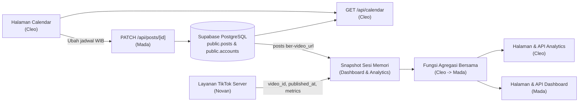

# S1-07 — Kontrak Data Calendar, Analytics, & Aturan Agregasi

- **Acuan kartu Trello:** `S1-07 · Kontrak Calendar dan Analytics` (`PIC: Cleo`)
- **Padanan draf rancangan:** `S1-09` pada [`Rancangan_Teknis_dan_Sprint_NobNob.md`](../../Rancangan_Teknis_dan_Sprint_NobNob.md)
- **Status:** **Siap review Mada dan Novan** *(belum disepakati lintas tim hingga review PR `#S1-07` selesai)*
- **Tanggal penyusunan:** 2026-11-19
- **Fixture pendamping (simulasi):** [`fixtures/s1-07-calendar-analytics.fixture.json`](fixtures/s1-07-calendar-analytics.fixture.json)

> **Catatan keamanan & non-persistensi:**
> - Contoh payload dan fixture pada dokumen ini berlabel **simulasi**, bukan data TikTok nyata.
> - Metrik performa TikTok (`views`, `likes`, `comments`, `shares`) hanya berada pada respons API server dan memori sesi tampilan; **tidak disimpan** di PostgreSQL Supabase, `localStorage`, `IndexedDB`, atau penyimpanan persisten browser lainnya.

---

## 1. Gambaran alur data & pembagian peran



- **Cleo** tidak menggarap modul CRUD Posts. Calendar hanya membaca jadwal dan melakukan perubahan jadwal melalui `PATCH /api/posts/[id]` milik Mada.
- **Mada** menyediakan kontrak `S1-08` (JSON Post, jadwal WIB, konversi durasi, format error), `PATCH /api/posts/[id]`, dan memakai fungsi agregasi Cleo di Dashboard agar total identik dengan Analytics.
- **Novan** menyediakan layanan server TikTok yang meneruskan `video_id` (`string`), `published_at`, metrik terkini (`integer | null`), dan status sinkronisasi/parsial.

---

## 2. Konvensi umum waktu, tipe data, dan format respons

1. **Zona waktu tampilan & batas periode:** **`Asia/Jakarta` (WIB, UTC+07:00)**, terlepas dari timezone browser pengguna maupun timezone OS server.
2. **Zona waktu penyimpanan DB:** `timestamptz` pada PostgreSQL (`posts.scheduled_at`, `posts.created_at`, `posts.updated_at`, `accounts.last_sync_at`).
3. **Format timestamp JSON:** ISO-8601 valid dengan zona waktu eksplisit (contoh `"2026-11-19T19:30:00+07:00"` atau UTC `Z` dari Supabase yang selalu diformat ke WIB saat dikelompokkan/ditampilkan; pada payload Calendar/Analytics disarankan `+07:00` atau konsisten dengan kesepakatan akhir `S1-08` Mada).
4. **Tipe ID video TikTok:** wajib **`string`** (contoh `"7438291045678901234"`), karena ID TikTok 64-bit melampaui batas integer aman JavaScript (`Number.MAX_SAFE_INTEGER = 9007199254740991`).
5. **Tipe metrik video:** `integer | null` (`>= 0` atau `null`). Nilai `0` adalah angka sah nol; `null` berarti metrik tidak tersedia/gagal diambil.
6. **Format respons bersama** (mengikuti [`Rancangan_Teknis_dan_Sprint_NobNob.md`](../../Rancangan_Teknis_dan_Sprint_NobNob.md#L220), diselaraskan dengan `S1-08` Mada):
   - Sukses: `{ "data": ..., "meta": ... }`
   - Gagal: `{ "error": { "code": "...", "message": "...", "fields": { ... } }, "requestId": "..." }`
   - Kode status standar: `401` (belum login), `403` (akses ditolak / tidak masuk whitelist aktif), `422` (parameter query/input tidak valid), `409` (konflik tautan saat mutasi Posts), `429`/`503` (limit atau gangguan layanan TikTok).

---

## 3. Kontrak field jadwal & Calendar (`GET /api/calendar`)

### 3.1 Hubungan dengan skema `public.posts` saat ini

Mengacu ke [`sql/20261110000100_nobnob_initial_schema.sql`](../../sql/20261110000100_nobnob_initial_schema.sql#L45-L67) dan [`src/components/Controls.jsx`](../../src/components/Controls.jsx#L6-L10):

| `posts.status` | Label UI | `scheduled_at` di DB | `video_url` di DB | Perlakuan di Calendar |
| --- | --- | --- | --- | --- |
| `draft` | `Draft` | Wajib `null` | Wajib `null` | **Tidak tampil** pada grid tanggal/agenda kalender karena belum memiliki jadwal. |
| `scheduled` | `Terjadwal` | Wajib `not null` | Wajib `null` | **Selalu tampil** di Calendar sesuai tanggal WIB `scheduled_at`. |
| `uploaded` | `Sudah Upload` | Boleh `not null` atau `null` | Wajib `not null` | **Tampil di Calendar bila `scheduled_at != null`** (mengikuti aturan visibilitas & izin ubah jadwal yang disepakati Mada pada `S1-08` / `PATCH /api/posts/[id]`). |

### 3.2 Parameter query `GET /api/calendar`

Calendar membutuhkan query rentang tanggal WIB eksplisit agar tampilan bulan (termasuk hari ekor minggu awal/akhir grid) dan tampilan agenda konsisten:

- `from` (`YYYY-MM-DD`, wajib jika `month` tidak dipakai): tanggal awal inklusif dalam WIB.
- `to` (`YYYY-MM-DD`, wajib jika `month` tidak dipakai): tanggal akhir inklusif dalam WIB (`from <= to`, batas rentang yang disarankan `<= 62` hari).
- `month` (`YYYY-MM`, alternatif opsional jika `from` & `to` tidak dikirim): oleh server dikonversi ke hari pertama s.d. hari terakhir bulan tersebut dalam WIB.
- `statuses` (opsional, dipisah koma, default `"scheduled,uploaded"`): menyaring status yang ditampilkan (hanya menerima nilai valid `scheduled`, `uploaded`).

**Aturan konversi batas rentang WIB → UTC untuk query PostgreSQL:**
Untuk `from = "2026-11-01"` dan `to = "2026-11-30"`:
- Batas awal inklusif: `2026-11-01T00:00:00.000+07:00` (`2026-10-31T17:00:00.000Z`)
- Batas akhir eksklusif: `(to + 1 hari)` → `2026-12-01T00:00:00.000+07:00` (`2026-11-30T17:00:00.000Z`)
- Filter SQL/Supabase: `scheduled_at >= start_utc AND scheduled_at < end_exclusive_utc`.

### 3.3 Contoh payload `GET /api/calendar?from=2026-11-01&to=2026-11-30`

```json
{
  "data": {
    "items": [
      {
        "id": "11111111-1111-4111-8111-111111111111",
        "title": "Promo Paket Makan Siang Jumat",
        "status": "scheduled",
        "status_label": "Terjadwal",
        "scheduled_at": "2026-11-20T11:30:00+07:00",
        "scheduled_date_wib": "2026-11-20",
        "scheduled_time_wib": "11:30",
        "duration_seconds": 45,
        "video_url": null,
        "video_id": null,
        "can_reschedule": true,
        "updated_at": "2026-11-19T10:15:00+07:00"
      },
      {
        "id": "22222222-2222-4222-8222-222222222222",
        "title": "Review Menu Baru Kopi Susu",
        "status": "uploaded",
        "status_label": "Sudah Upload",
        "scheduled_at": "2026-11-18T19:00:00+07:00",
        "scheduled_date_wib": "2026-11-18",
        "scheduled_time_wib": "19:00",
        "duration_seconds": 60,
        "video_url": "https://www.tiktok.com/@kedainobnob/video/7438291045678901234",
        "video_id": "7438291045678901234",
        "can_reschedule": false,
        "updated_at": "2026-11-18T19:05:00+07:00"
      }
    ]
  },
  "meta": {
    "timezone": "Asia/Jakarta",
    "from_wib": "2026-11-01",
    "to_wib": "2026-11-30",
    "range_start": "2026-11-01T00:00:00+07:00",
    "range_end_exclusive": "2026-12-01T00:00:00+07:00",
    "total_items": 2
  }
}
```

### 3.4 Kontrak ubah jadwal dari Calendar (memakai `PATCH /api/posts/[id]` Mada)

- Request ubah jadwal dari Calendar mengirim:
  ```json
  {
    "scheduled_at": "2026-11-22T18:00:00+07:00"
  }
  ```
- **Catatan kesepakatan dengan Mada (`S1-08`):**
  1. Nilai `can_reschedule` pada Post berstatus `uploaded` mengikuti aturan final `PATCH /api/posts/[id]` Mada (apakah `uploaded` dikunci jadwalnya atau tetap boleh diubah).
  2. Apabila penyimpanan gagal (`422`, `409`, atau `5xx`), modal/form Calendar tetap mempertahankan input jadwal pengguna dan menampilkan pesan dari `error.message`.
  3. Apabila sukses, tampilan Posts, Calendar, dan Dashboard wajib tersinkronisasi.

---

## 4. Kontrak input dari layanan TikTok Novan

Untuk menghitung Analytics dan ringkasan Dashboard secara konsisten, fungsi agregasi Cleo membutuhkan kontrak data berikut dari layanan server TikTok Novan (atau fixture simulasi selama pengembangan):

### 4.1 Field wajib per video & metadata batch pengambilan

| Field | Tipe | Sumber & aturan |
| --- | --- | --- |
| `video_id` | `string` | ID video TikTok sebagai **string** (contoh `"7438291045678901234"`), dicocokkan dengan ID pada `posts.video_url`. |
| `video_url` | `string \| null` | URL kanonik TikTok jika tersedia (`https://www.tiktok.com/@username/video/{id}`). |
| `published_at` | `string \| null` | Timestamp unggah aktual dari TikTok (`create_time` → ISO-8601). **Tidak boleh** diisi dengan `posts.created_at`, `posts.scheduled_at`, atau `last_sync_at` jika TikTok tidak mengembalikannya. |
| `metrics.views` | `integer \| null` | Total views terkini (`view_count`). Nilai sah nol = `0`; tidak tersedia/gagal = `null`. |
| `metrics.likes` | `integer \| null` | Total likes terkini (`like_count`). Nilai sah nol = `0`; tidak tersedia/gagal = `null`. |
| `metrics.comments` | `integer \| null` | Total komentar terkini (`comment_count`). Nilai sah nol = `0`; tidak tersedia/gagal = `null`. |
| `metrics.shares` | `integer \| null` | Total shares terkini (`share_count`). Nilai sah nol = `0`; tidak tersedia/gagal = `null`. |
| `metrics_state` | `"ok" \| "partial" \| "unavailable"` | `"ok"` bila keempat metrik non-null; `"partial"` bila sebagian non-null & sebagian `null`; `"unavailable"` bila keempatnya `null`. |

Metadata tingkat batch (`fetchMeta`) dari layanan Novan:
- `fetch_status`: `"ok" | "partial" | "failed" | "disconnected"`
- `fetched_at`: `string | null` (ISO-8601 waktu pengambilan selesai)
- `source`: `"tiktok_api" | "session_memory" | "simulation_fixture"`
- `error`: `null | { code: string, message: string }`

### 4.2 Contoh payload respons layanan TikTok Novan (kondisi lengkap & parsial)

```json
{
  "account": {
    "status": "connected",
    "open_id": "tt_open_001",
    "display_name": "Kedai NobNob"
  },
  "fetch_meta": {
    "fetch_status": "partial",
    "fetched_at": "2026-11-19T16:00:00+07:00",
    "source": "simulation_fixture",
    "error": {
      "code": "TIKTOK_PARTIAL_TIMEOUT",
      "message": "Sebagian statistik video gagal diambil dari TikTok."
    }
  },
  "videos": [
    {
      "video_id": "7438291045678901234",
      "video_url": "https://www.tiktok.com/@kedainobnob/video/7438291045678901234",
      "published_at": "2026-11-18T19:00:00+07:00",
      "metrics": {
        "views": 12400,
        "likes": 850,
        "comments": 42,
        "shares": 19
      },
      "metrics_state": "ok"
    },
    {
      "video_id": "7438291045678905678",
      "video_url": "https://www.tiktok.com/@kedainobnob/video/7438291045678905678",
      "published_at": "2026-11-15T12:15:00+07:00",
      "metrics": {
        "views": 300,
        "likes": 0,
        "comments": null,
        "shares": 0
      },
      "metrics_state": "partial"
    }
  ]
}
```

---

## 5. Aturan agregasi bersama (`Analytics` & `Dashboard`) dan kondisi data kosong

Aturan ini berlaku **identik** untuk halaman/endpoint Analytics (`Cleo`) maupun Dashboard (`Mada`) melalui satu fungsi agregasi bersama.

### 5.1 Aturan penautan & deduplikasi video
1. **Hanya Post yang sudah tertaut ke video** (`posts.video_url` non-null dan berformat valid `/video/<digits>`) yang diikutkan. Video TikTok yang belum ditautkan ke Post (`Belum ditautkan`) **tidak dihitung** ke total maupun daftar konten teratas.
2. **Ekstraksi ID sebagai string:** ambil segmen digit di akhir `posts.video_url` (sama seperti index unik DB `substring(video_url from '[0-9]+$')`).
3. **Deduplikasi `video_id`:**
   - Lakukan deduplikasi pada array `linkedPosts` maupun `tiktokVideos` menggunakan kunci `video_id` (`string`).
   - Bila ditemukan duplikat `video_id` pada input `tiktokVideos` (mis. karena pagination cursor), ambil satu entri dengan prioritas: (a) jumlah field metrik non-null terbanyak, lalu (b) memiliki `published_at`, lalu (c) kemunculan terakhir. **Tidak boleh dijumlahkan dua kali.**

### 5.2 Aturan filter periode berbasis `published_at` (WIB)
1. **Dasar filter adalah `video.published_at`**, bukan `posts.created_at`, `posts.scheduled_at`, ataupun `fetched_at`.
2. **Konversi batas periode inklusif per hari kalender WIB (`Asia/Jakarta`, UTC+07:00):**
   - `preset = "7d"`: `from_wib = today_wib - 6 hari`, `to_wib = today_wib` (tepat 7 hari kalender WIB, termasuk hari ini).
   - `preset = "30d"`: `from_wib = today_wib - 29 hari`, `to_wib = today_wib` (tepat 30 hari kalender WIB, termasuk hari ini).
   - `preset = "custom"`: `from_wib = from` (`YYYY-MM-DD`), `to_wib = to` (`YYYY-MM-DD`), wajib `from <= to`.
   - `preset = "all"`: opsional untuk ringkasan tanpa batas tanggal (mis. jika Dashboard membutuhkan ringkasan keseluruhan video tertaut selain preset `7d`/`30d`).
   - Video lolos filter jika `published_at` valid dan memenuhi `range_start_utc <= published_at_utc < range_end_exclusive_utc`.
3. **Jika video tertaut tidak ditemukan pada respons TikTok atau `published_at === null`:**
   - Video **tidak lolos** filter periode tanggal unggah (tidak ditebak tanggalnya).
   - Video dicatat ke `unresolved_videos` (dengan alasan `"missing_in_tiktok_response"` atau `"missing_published_at"`) dan menurunkan status cakupan menjadi `"partial"` (atau `"failed"` jika semua video tertaut tak memiliki data).

### 5.3 Aturan nilai kosong (`null`) vs nol (`0`), kondisi parsial, & gagal

Setiap metrik `m ∈ { views, likes, comments, shares }` pada objek `totals` menggunakan struktur `{ value, status, available_count, missing_count }` dengan rumus deterministik berikut:

- `available_count(m)` = jumlah video tertaut yang lolos filter `published_at` dan memiliki nilai angka (`integer >= 0`) untuk metrik `m`.
- `missing_count(m)` = `(jumlah video lolos filter dengan metrics[m] === null) + coverage.unresolved_count`. *(Catatan: `unresolved_count` ikut dihitung karena video tertaut yang gagal di-fetch / tanpa `published_at` tidak bisa dipastikan di luar periode, sehingga status tetap bertanda `partial` dan UI menampilkan cakupan secara jujur.)*

| Kondisi | `state` ringkasan | `totals[m].value` | `totals[m].status` | Aturan tampilan UI |
| --- | --- | --- | --- | --- |
| Belum ada Post dengan `video_url` | `"no_linked_videos"` | `null` | `"empty"` | Tampilkan pesan kosong ("Belum ada video tertaut"), **bukan angka `0`**. |
| Ada Post tertaut, tapi 0 video lolos filter `published_at` periode | `"empty_in_period"` | `null` | `"empty"` | Tampilkan pesan periode kosong ("Belum ada video yang diunggah pada rentang tanggal ini"), **bukan `0`**. *(Tetap laporkan `unresolved_count` bila ada video tertaut yang gagal ter-resolve sehingga periode tidak bisa dipastikan lengkap.)* |
| Semua video tertaut yang masuk cakupan punya metrik lengkap & sah (termasuk `0`) | `"complete"` | `integer` (`>= 0`) | `"complete"` | Angka `0` tampil sebagai `0` yang sah. |
| Sebagian video gagal di-resolve / tanpa `published_at` / sebagian metrik `null`, tetapi minimal 1 video punya angka valid untuk metrik `m` | `"partial"` | `integer` (`>= 0`, jumlah dari yang tersedia) | `"partial"` | Tampilkan angka + badge cakupan parsial (contoh: `"3 dari 4 video tertaut"`). |
| Ada video pada periode (atau tertaut), tetapi 0 video punya angka valid untuk metrik `m` | `"partial"` atau `"failed"` | `null` | `"unavailable"` | Tampilkan kosong (`—` / "Data tidak tersedia"), **jangan ubah `null` menjadi `0`**. |
| Akun TikTok terputus / perlu hubungkan ulang & belum ada snapshot di memori sesi | `"disconnected"` atau `"failed"` | `null` | `"unavailable"` | Tampilkan status akun / gagal beserta tombol hubungkan atau sinkronkan ulang. |
| Pengambilan terbaru gagal (`fetch_status === "failed"`), tetapi snapshot sebelumnya masih ada di memori sesi | Mempertahankan `state` snapshot sebelumnya dengan `meta.is_stale = true` | Nilai snapshot sebelumnya | Status snapshot sebelumnya | Tampilkan data sebelumnya + waktu `meta.fetched_at` + peringatan bahwa pembaruan terakhir gagal. |

### 5.4 Aturan peringkat konten teratas (`top_videos`)
- Hanya mencakup video tertaut yang lolos filter tanggal unggah `published_at`.
- Diurutkan menurun (`descending`) berdasarkan metrik pilihan (default `views`).
- Video dengan nilai metrik `null` selalu diletakkan **di bawah** video yang bernilai angka (termasuk di bawah nilai sah `0`).
- Tie-breaker urutan: `published_at` terbaru lebih dulu, lalu `video_id` menaik agar deterministik di Analytics dan Dashboard.

### 5.5 Kontrak fungsi agregasi bersama (untuk Mada / `S2-C05`)

```ts
// Kontrak tanda tangan fungsi murni (JavaScript di implementasi Sprint 2)
aggregateLinkedVideoStats({
  linkedPosts,   // Array<{ id, title, video_url, scheduled_at, status }>
  tiktokVideos,  // Array<{ video_id, video_url?, published_at, metrics: { views, likes, comments, shares }, metrics_state? }>
  period,        // { preset: "7d" | "30d" | "custom" | "all", from?: string, to?: string, now?: string | Date }
  fetchMeta,     // { fetch_status, fetched_at, source, error?, is_stale? }
  sortBy,        // "views" | "likes" | "comments" | "shares" (default: "views")
})
```

---

## 6. Contoh payload respons `GET /api/analytics`

### 6.1 Kondisi parsial + ada nilai sah `0` & nilai `null` (`GET /api/analytics?preset=7d`)

Misalkan pada rentang `2026-11-13` s.d. `2026-11-19` WIB terdapat 3 Post bertautan video:
- Video A (`published_at: 2026-11-18T19:00:00+07:00`): `views: 12400, likes: 850, comments: 42, shares: 19`
- Video B (`published_at: 2026-11-15T12:15:00+07:00`): `views: 300, likes: 0, comments: null, shares: 0`
- Video C (`video_id: 7438291045678909999`): gagal ter-resolve dari respons TikTok (`missing_in_tiktok_response`)

Hasil payload `GET /api/analytics?preset=7d` (sama persis dengan keluaran fungsi agregasi untuk Dashboard pada periode yang sama):

```json
{
  "data": {
    "state": "partial",
    "period": {
      "preset": "7d",
      "from_wib": "2026-11-13",
      "to_wib": "2026-11-19",
      "timezone": "Asia/Jakarta"
    },
    "coverage": {
      "linked_posts_count": 3,
      "deduplicated_videos_count": 3,
      "resolved_count": 2,
      "matched_period_count": 2,
      "unresolved_count": 1,
      "is_complete": false
    },
    "totals": {
      "views": { "value": 12700, "status": "partial", "available_count": 2, "missing_count": 1 },
      "likes": { "value": 850, "status": "partial", "available_count": 2, "missing_count": 1 },
      "comments": { "value": 42, "status": "partial", "available_count": 1, "missing_count": 2 },
      "shares": { "value": 19, "status": "partial", "available_count": 2, "missing_count": 1 }
    },
    "top_videos": [
      {
        "post_id": "22222222-2222-4222-8222-222222222222",
        "post_title": "Review Menu Baru Kopi Susu",
        "video_id": "7438291045678901234",
        "video_url": "https://www.tiktok.com/@kedainobnob/video/7438291045678901234",
        "published_at": "2026-11-18T19:00:00+07:00",
        "published_date_wib": "2026-11-18",
        "metrics": { "views": 12400, "likes": 850, "comments": 42, "shares": 19 },
        "metrics_state": "ok"
      },
      {
        "post_id": "33333333-3333-4333-8333-333333333333",
        "post_title": "Teaser Minuman Sore",
        "video_id": "7438291045678905678",
        "video_url": "https://www.tiktok.com/@kedainobnob/video/7438291045678905678",
        "published_at": "2026-11-15T12:15:00+07:00",
        "published_date_wib": "2026-11-15",
        "metrics": { "views": 300, "likes": 0, "comments": null, "shares": 0 },
        "metrics_state": "partial"
      }
    ],
    "unresolved_videos": [
      {
        "post_id": "44444444-4444-4444-8444-444444444444",
        "post_title": "Promo Akhir Pekan",
        "video_id": "7438291045678909999",
        "reason": "missing_in_tiktok_response"
      }
    ]
  },
  "meta": {
    "fetched_at": "2026-11-19T16:00:00+07:00",
    "fetch_status": "partial",
    "source": "simulation_fixture",
    "is_stale": false,
    "error": {
      "code": "TIKTOK_PARTIAL_TIMEOUT",
      "message": "Sebagian statistik video gagal diambil dari TikTok."
    }
  }
}
```

### 6.2 Kondisi kosong belum ada video tertaut (`no_linked_videos`)

```json
{
  "data": {
    "state": "no_linked_videos",
    "period": {
      "preset": "7d",
      "from_wib": "2026-11-13",
      "to_wib": "2026-11-19",
      "timezone": "Asia/Jakarta"
    },
    "coverage": {
      "linked_posts_count": 0,
      "deduplicated_videos_count": 0,
      "resolved_count": 0,
      "matched_period_count": 0,
      "unresolved_count": 0,
      "is_complete": true
    },
    "totals": {
      "views": { "value": null, "status": "empty", "available_count": 0, "missing_count": 0 },
      "likes": { "value": null, "status": "empty", "available_count": 0, "missing_count": 0 },
      "comments": { "value": null, "status": "empty", "available_count": 0, "missing_count": 0 },
      "shares": { "value": null, "status": "empty", "available_count": 0, "missing_count": 0 }
    },
    "top_videos": [],
    "unresolved_videos": []
  },
  "meta": {
    "fetched_at": "2026-11-19T16:00:00+07:00",
    "fetch_status": "ok",
    "source": "simulation_fixture",
    "is_stale": false,
    "error": null
  }
}
```

Contoh skenario tambahan (lengkap dengan angka sah `0`, periode kosong `empty_in_period`, dan error gagal total `failed`) tersedia di [`fixtures/s1-07-calendar-analytics.fixture.json`](fixtures/s1-07-calendar-analytics.fixture.json).

---

## 7. Poin yang perlu disepakati bersama Mada dan Novan saat review `#S1-07`

1. **Untuk Mada (`S1-08` & `PATCH /api/posts/[id]` / Dashboard):**
   - Konfirmasi apakah Post berstatus `uploaded` (dengan `scheduled_at != null`) tampil read-only di Calendar (`can_reschedule: false`) atau juga boleh diubah tanggalnya.
   - Konfirmasi apakah `GET /api/calendar` akan disediakan oleh Cleo dengan query `from`/`to` (dan `month` opsional) dalam WIB, dan format envelope `{ data, meta }` / `{ error, requestId }` sudah sama dengan `S1-08`.
   - Konfirmasi kebutuhan periode pada Dashboard (`7d` / `30d` / `all`) untuk fungsi `aggregateLinkedVideoStats(...)`.
2. **Untuk Novan (Accounts & TikTok integration):**
   - Konfirmasi bahwa layanan TikTok server meneruskan `video_id` sebagai `string`, `published_at` dari `create_time` (atau `null` bila tidak tersedia), metrik `integer | null` (tidak mengubah error/kosong menjadi `0`), serta `fetch_meta` (`fetch_status`, `fetched_at`, `error`).

## 8. Hasil verifikasi dokumen

- Validasi sintaks JSON pada [`fixtures/s1-07-calendar-analytics.fixture.json`](fixtures/s1-07-calendar-analytics.fixture.json) lolos tanpa error.
- Pemeriksaan kecocokan terhadap skema [`sql/20261110000100_nobnob_initial_schema.sql`](../../sql/20261110000100_nobnob_initial_schema.sql) dan [`src/components/Controls.jsx`](../../src/components/Controls.jsx) sesuai pada 2026-11-19.
- Perubahan hanya berupa dokumentasi dan fixture simulasi (tidak ada perubahan kode aplikasi Next.js sehingga `build`/`lint` tidak terpengaruh; tetap diperiksa validitas JSON dan tautan lokal).
